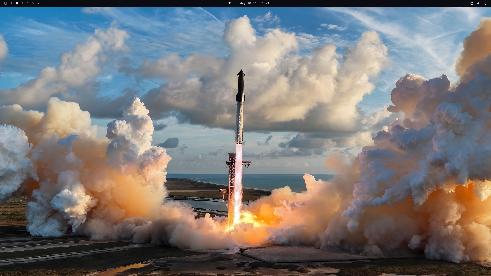
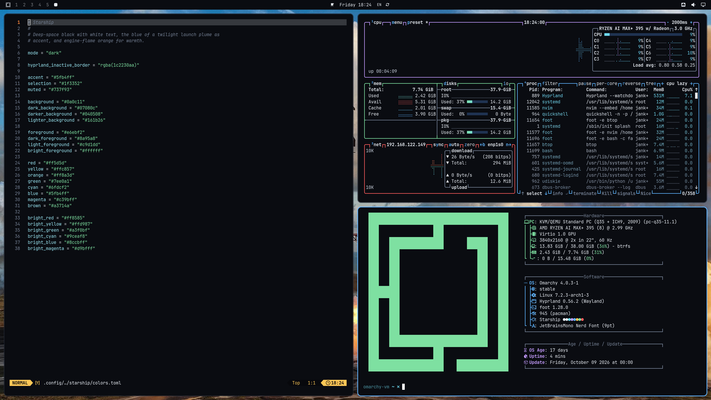
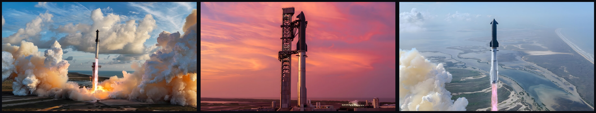

# Starship

A Starship celebration theme for [Omarchy](https://omarchy.org): deep-space black, the blue of a launch sky, and engine-flame orange, on top of SpaceX's own launch photography upscaled to 8K.





## Install

```bash
omarchy theme install https://github.com/jankeesvw/omarchy-starship-theme
```

Cycle the backgrounds with `omarchy theme bg next`.

## Backgrounds



- `1-starship-flight-14-launch.jpg`: Flight 14 clearing the tower at Starbase, the flight that took Starship to orbit for the first time
- `2-starship-flight-13-on-the-pad.jpg`: Flight 13 stacked on the pad under a pink sky
- `3-starship-flight-12-liftoff.jpg`: Flight 12, a Starship V3, climbing out over the Texas coast

All three are 7680x4320 (8K). On a wider or taller screen Omarchy crops the sides, and the rocket stays in the middle.

### How they were upscaled

SpaceX publishes these photos at 2600x1200. Plain resizing (Lanczos) to 8K made them look soft and blew up the JPEG artifacts, so they went through [Real-ESRGAN](https://github.com/xinntao/Real-ESRGAN) instead, which rebuilds edges and removes compression noise rather than just stretching the pixels:

```bash
# 1. Crop the 2600x1200 original to 16:9 around the rocket
magick flight-14.jpg -gravity center -crop 2133x1200+0+0 +repage crop.png

# 2. Upscale 4x with Real-ESRGAN (realesrgan-ncnn-vulkan, model realesrgan-x4plus)
realesrgan-ncnn-vulkan -i crop.png -o upscaled.png -n realesrgan-x4plus -s 4

# 3. Scale the 8532x4800 result down to exactly 8K
magick upscaled.png -filter Lanczos -resize 7680x4320! -quality 92 1-starship-flight-14-launch.jpg
```

Step 3 only ever shrinks the image, so every pixel comes from the Real-ESRGAN output and nothing is stretched. On Arch, `realesrgan-ncnn-vulkan-bin` from the AUR provides the binary and the models.

**These photos are not mine.** They were taken by SpaceX and come from the mission pages on [spacex.com](https://www.spacex.com). All rights stay with SpaceX. See [CREDITS.md](CREDITS.md) for the source of each one.

## Palette

| | | |
|---|---|---|
| `#0a0c11` | deep-space black | window background |
| `#e6ebf2` | cool white | text |
| `#5fb4ff` | launch-sky blue | accent, active window border |
| `#ff8a3d` | engine-flame orange | warm highlights |
| `#1f3352` | night navy | selection |

Text sits at 16.3:1 against the background, the accent at 8.8:1 and the muted grey at 4.8:1, so even comments stay readable. Selection is a deep navy rather than a lighter tint, because Omarchy draws selected text in white and white on `#1f3352` still gets 10.6:1.
